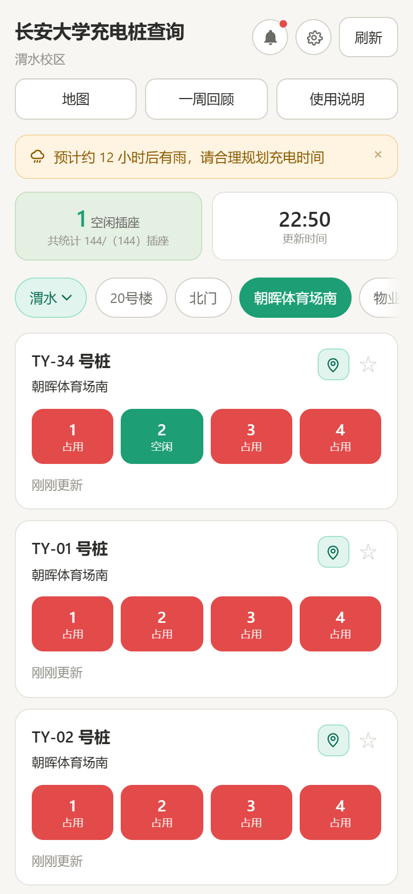
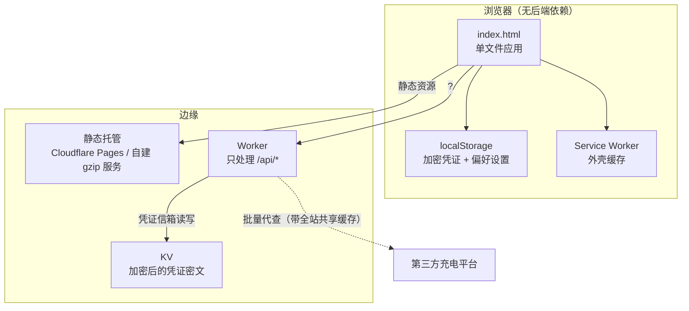

# 长安大学充电桩查询

> 一个页面看清校园里每台共享充电桩还剩几个空位，不用装 App、不用登录、不用扫码。

<p align="center">
  
</p>

<p align="center">
  <code>纯前端单页</code> · <code>无构建、无框架、无 npm</code> · <code>177 台桩 / 7 个分区 / 4 个校区（小寨待接入）</code> · <code>v2.81</code>
</p>

---

## 这是什么

长安大学渭水校区的共享充电桩，分散在北门、朝晖体育场南、20 号楼、物业服务中心四个区域。
以前要查空位只能走到桩前扫码，或者一个个点开小程序看 —— 结果常常是**走到那儿才发现全被占了**。

这个项目把「哪台桩现在有几个空位」直接摊在一张手机页面上：

- 打开即见 **空闲插座总数** 和 **更新时间**
- 每台桩一张卡片，绿点 = 空闲、红点 = 占用，一眼扫完
- 支持按地址筛选、按编号/空闲数排序、收藏常用桩
- 有地图视图（高德），分区块看桩位分布
- 断网也能打开（Service Worker 缓存外壳），只是数据会标灰

数据来自第三方充电平台的扫码接口，凭证由使用者自己提供并保存在**浏览器本地**，服务端只存一段加密后的密文用于跨设备同步。

## 特性

| 能力 | 说明 |
|---|---|
| **零依赖前端** | 原生 HTML/CSS/JS，改完文件直接就是产物，没有构建步骤 |
| **凭证信箱** | 站长在 `/admin` 上传一次，全班自动同步；AES-GCM + PBKDF2 加密后存 KV，服务端读不到明文 |
| **离线可用** | Service Worker 预缓存外壳与底图，断网仍能看列表结构和上次的结果 |
| **并发受控** | 逐台查询并发 6、单批 12 台、双泳道，避开平台按出口 IP 的风控 |
| **皮肤与字体** | 4 种风格 × 4 种材质 × 3 档字体，全部走 CSS 变量，可自由组合 |
| **守门检查** | 静态断言守着版本号同升、缓存一致性、服务端 gzip/反代配置、对外目录由真源生成 |
| **对外目录** | `catalog.json` 把设备清单、分区与 GCJ-02 坐标摊平成静态 JSON，第三方应用不必解析页面 |

## 它是怎么工作的



默认由浏览器逐台直连平台（省掉中间跳数，也把风控压力分散到每个真实用户）；
URL 加 `?pileproxy=1` 切到服务端代查 —— 既是出口网络打不通平台时的救急手段，也是自动化测试必需的通道。
两种路径共用同一套并发上限，避免「自己把自己打挂」。

## 第三方应用接入

设备清单和桩位坐标**本来就是公开数据**，只是过去只以「页面」的形态存在：清单内联在
`index.html`，坐标由 `map-amap.js` 在浏览器里现算。别的应用想接进来，只能去抠 500 KB 的 HTML、
再把三套落点算法重写一遍 —— 而且站点一改版，它们就静默错位。

所以额外产出一份静态目录：

```
GET https://chd-charge.pages.dev/catalog.json    # 全部设备 + 分区 + GCJ-02 坐标
```

它是静态文件：不走 Worker、不消耗 Functions 额度、无鉴权，带 `Access-Control-Allow-Origin: *`，
网页应用也能直接 `fetch`。

**它是构建产物，不进入版本库**：`make_cloudflare.py` / `make_dist.py` 打包时调
`tools/gen_catalog.py` 生成，`serve_gzip.py` 启动时也会在内存里生成一份。
所以改了 `DEFAULT_DEVICES` 之后不需要任何手工步骤。

实时状态、全校快照、一周统计的接口形状、缓存与限额见 **[docs/API.md](docs/API.md)**。

一句话原则：**首屏用 `/api/snap?area=all` 一次铺满，用户点刷新才用 `/api/pile` 打当前分区**。
一进来就全量扫，正是当年把出口 IP 打进平台风控、整片 TCP 超时的那种打法。

## 快速开始

只需要 Python 3.10+，不需要安装任何依赖。

```bash
git clone https://github.com/Qishihe/longsong-chd-charger.git
cd longsong-chd-charger/campus-pile-kit/chd-charge
python -m http.server 8080
# 浏览器打开 http://127.0.0.1:8080/index.html
```

打开后是**没有数据**的 —— 因为还没有凭证。照 `help.html` 里的图文教程取一串凭证，
粘进页面「设置 › 设备凭证」即可。

配地图还需要一个高德 Key：复制 `map-key.example.js` 为 `map-key.local.js`，
按里面的六步填自己的 Key 与安全密钥（前端 Key 必然公开，域名白名单是唯一有效防护）。
**不配也能用，只是地图页签打不开。**

## 部署

站点是纯静态的，可部署到任何静态托管。

**Cloudflare Pages**

```bash
cd campus-pile-kit
python tools/make_cloudflare.py     # → dist-cloudflare/ 与 dist-cloudflare.zip
```

把 `dist-cloudflare.zip` 拖进 Cloudflare 控制台的 Create deployment 即可
（或 `npx wrangler pages deploy dist-cloudflare`）。
⚠️ 必须传 **zip**、且 zip 顶层就是站点根 —— 套一层目录会导致根路径 404。

**任意 HTTP 服务器 / 需要 `/api/*` 反代时**

```bash
cd campus-pile-kit/chd-charge
PORT=8080 python serve_gzip.py
```

`serve_gzip.py` 是自带 gzip + ETag 的静态服务器，并反代 `/api/*` 到上游 Worker
（伪装浏览器 UA、改写 Origin —— 两件事漏一件就会被 Cloudflare 拦成 1010 / 403）。

## 目录结构

```
campus-pile-kit/
├── chd-charge/          站点根目录（会被整包发布，别放私密文件）
│   ├── index.html       单文件应用（脚本内联）
│   ├── admin.html       站长上传凭证页
│   ├── help.html        取凭证的图文教程
│   ├── map-amap.js      地图引擎
│   ├── map-data.js      分区登记 + 底图坐标
│   ├── catalog.json     对外设备目录（构建产物，打包时自动生成）
│   ├── map-*.webp       底图
│   ├── sw.js            Service Worker
│   ├── serve_gzip.py    发布用服务器（静态 + gzip + /api 反代）
│   └── icons/           PWA 图标与 favicon
├── tools/               打包 / 守门 / 图标生成 / 部署
├── docs/                部署文档
├── android-app/         Android WebView 壳（只加载线上站点）
└── snapshot-worker/     定时采样与统计的 Cloudflare Worker（D1）
```

## 验收

改动完发布前跑一遍守门：

```bash
python campus-pile-kit/tools/gen_snapshot_partitions.py --check   # 分区表与 DEFAULT_DEVICES 一致
python campus-pile-kit/tools/gen_catalog.py --check               # 对外目录生成器自检
python campus-pile-kit/tools/check_release.py                     # 发布体检（含上面两条的等价断言）
```

`check_release.py` 检查的是「最容易静默出错」的那几类东西：版本号三处是否同升、
Service Worker 缓存名是否跟着换、预缓存清单与页面引用是否逐字一致、
`serve_gzip.py` 的反代与 gzip 配置是否正确、注释里有没有会提前闭合的 `*/`。

改了 `DEFAULT_DEVICES`（加桩、改桩号、加分区）之后：`partitions.mjs` 是 wrangler 的部署输入、
必须提交，所以那条 `--check` 会先红，重跑生成器再提交；`catalog.json` 是构建产物、不进版本库，
打包时自动生成，**不需要任何手工步骤**。

## 文档

| 文档 | 内容 |
|---|---|
| [docs/API.md](docs/API.md) | **对外接口契约**：设备目录、实时状态、快照、统计、限额与接入建议 |
| [docs/DEVELOPMENT.md](docs/DEVELOPMENT.md) | 从零开始的完整开发历程：技术路线怎么定的、哪一步走错了、哪些坑必然踩 |
| [campus-pile-kit/docs/DEPLOY-CLOUDFLARE.md](campus-pile-kit/docs/DEPLOY-CLOUDFLARE.md) | Cloudflare Pages 部署步骤与高德白名单 |
| [campus-pile-kit/docs/DEPLOY-GUIDE.md](campus-pile-kit/docs/DEPLOY-GUIDE.md) | 自建服务器部署（systemd / nginx） |
| [campus-pile-kit/docs/纯静态部署步骤.md](campus-pile-kit/docs/纯静态部署步骤.md) | 纯静态托管的最短路径 |

## 免责声明

- 本项目是**学生公益项目**，与长安大学及任何充电桩运营商无隶属关系。
- 数据来自第三方平台的公开查询接口，本项目**不存储任何他人账户信息**；凭证由使用者自行提供，仅保存在自己的浏览器里。
- 查询结果仅供参考，实际可用状态以现场为准。请勿用于商业用途或高频自动化抓取 —— 那会让他人无法使用。
- 仓库内**不含**任何真实密钥、口令或抓包凭证；`*.local.js`、抓包存档等均已在 `.gitignore` 中排除。

## 许可

[Mozilla Public License 2.0](LICENSE)（MPL-2.0）· © 2026 长歌 (Changge)

- 可以自由使用、修改、分发，包括并入闭源项目 —— 前提是：**被你修改过的那些源文件**继续以 MPL 2.0 分发，并让拿到产品的人能取到它们的源码。
- 没有改动过的文件、你自己新写的文件不受此约束，可以和它们一起闭源分发。
- 内含明示的专利授权与「专利报复」条款；同时明确**不授予商标权**（请勿使用项目名与本项目图标作为你的产品标识）。
- 2026-11-01 之前发布的提交仍按当时的 MIT 许可发布，可从 git 历史取用；此后版本适用 MPL 2.0。
- 版权与单文件标注方式见 [NOTICE](NOTICE)。

## 致谢

感谢参与数据采集、拍摄照片、核对桩位信息的同学：**F.、ditto、W、元气少女**。

特别感谢 **MyCHD** 作者 **Rinn**，为本项目的地图开发提供了思路与实现参考。

本项目在开发过程中参考、使用了以下开源项目：

- [MyCHD](https://github.com/RinnMoe/my_chu)
- [汕头大学充电桩监控](https://github.com/zhuangchuyuan86-bot/stu-charge-watch)

向所有开源开发者致谢 —— 开源社区的共享精神，是这个项目能实现的重要技术支撑。
