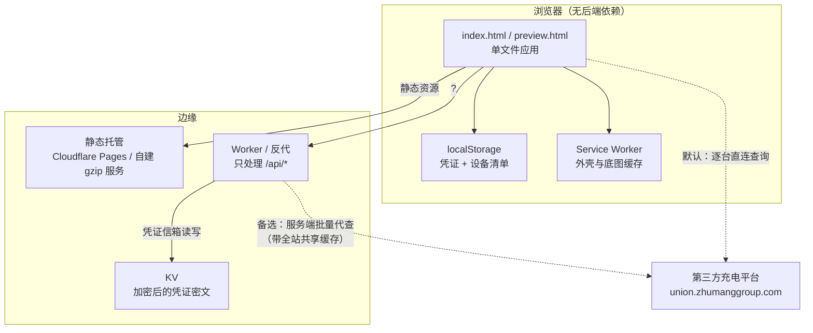

# 长安大学充电桩查询

> 一个页面看清校园里每台共享充电桩还剩几个空位，不用装 App、不用登录、不用扫码。

<p align="center">
  
</p>

<p align="center">
  <code>纯前端单页</code> · <code>无构建、无框架、无 npm</code> · <code>109 台桩 / 4 个分区</code> · <code>当前版本 v2.19</code>
</p>

---

## 这是什么

长安大学渭水校区的共享充电桩，分散在北门、朝晖体育场南、20 号楼、物业服务中心四个区域。
以前要查空位只能走到桩前扫码，或者一个个点开小程序看 —— 结果常常是**走到那儿才发现全被占了**。

这个项目把「哪台桩现在有几个空位」直接摊在一张手机页面上：

- 打开即见 **空闲插座总数** 和 **更新时间**
- 每台桩一张卡片，绿点 = 空闲、红点 = 占用，一眼扫完
- 支持按地址筛选、按编号/空闲数排序、收藏常用桩
- 有地图视图（高德），分区块看桩位分布
- 断网也能打开（Service Worker 缓存外壳），只是数据会标灰

数据来自第三方充电平台的扫码接口，凭证由使用者自己提供并保存在**浏览器本地**，服务端只存一段加密后的密文用于跨设备同步。

## 特性

| 能力 | 说明 |
|---|---|
| **零依赖前端** | 原生 HTML/CSS/JS，改完文件直接就是产物，没有构建步骤 |
| **双轨发布** | `preview.html` 内测、`index.html` 正式，由脚本从内测版逐处生成正式版，每处替换都断言只命中一次 |
| **凭证信箱** | 站长在 `/admin` 上传一次，全班自动同步；AES-GCM + PBKDF2 加密后存 KV，服务端读不到明文 |
| **离线可用** | Service Worker 预缓存外壳与底图数据，断网仍能看列表结构和历史数据 |
| **并发受控** | 逐台查询并发 6、分批 12、双泳道，避开平台按出口 IP 的风控 |
| **可回退** | 每次发布打整包快照，一条命令 dry-run 回退到任一历史版本 |
| **守门检查** | 44 项静态断言守着双轨一致性、敏感文件不外泄、服务端 gzip/反代配置正确 |

## 它是怎么工作的



两条查询路径并存：默认由浏览器逐台直连平台（省掉中间跳数，也把风控压力分散到每个真实用户）；
URL 加 `?pileproxy=1` 可切回服务端反代 —— 既是出口网络打不通平台时的救急手段，也是自动化测试必需的通道。

## 快速开始

只需要 Python 3.10+，不需要安装任何依赖。

```bash
git clone https://github.com/Qishihe/longsong-chd-charger.git
cd longsong-chd-charger/campus-pile-kit/chd-charge
python -m http.server 8080
# 浏览器打开 http://127.0.0.1:8080/index.html
```

打开后是**没有数据**的 —— 因为还没有凭证。两种方式让它动起来：

1. **接真实平台**：照 `help.html` 里的图文教程抓一串凭证，粘进页面「设置」里；
2. **用本地桩服务**（推荐，纯离线）：
   ```bash
   python ../scratch/pile_stub.py 8080     # 同时提供静态页与 /api/pile 假数据
   # 打开 http://127.0.0.1:8080/index.html?box=1&pileproxy=1
   ```

配地图还需要一个高德 Key：复制 `map-key.example.js` 为 `map-key.local.js`，按里面的六步填自己的 Key 与安全密钥（前端 Key 必然公开，域名白名单是唯一有效防护）。**不配也能用，只是地图页签打不开。**

## 部署

站点是纯静态的，可部署到任何静态托管。仓库自带两种布置方式：

**Cloudflare Pages**（线上主站）

```bash
cd campus-pile-kit
python tools/make_cloudflare.py     # → dist-cloudflare/ 与 dist-cloudflare.zip
```

把 `dist-cloudflare.zip` 拖进 Cloudflare 控制台的 Create deployment 即可。
⚠️ 必须传 **zip**、且 zip 顶层就是站点根 —— 套一层目录会导致根路径 404。

**任意 HTTP 服务器 / 需要 `/api/*` 反代时**

```bash
cd campus-pile-kit/chd-charge
PORT=8080 python serve_gzip.py
```

`serve_gzip.py` 是自带 gzip + ETag 的静态服务器，并反代 `/api/*` 到上游 Worker
（伪装浏览器 UA、改写 Origin —— 两件事漏一件就会被 Cloudflare 拦成 1010 / 403）。

发布前的硬约束、版本号三处同升、回退流程，全部写在 [`campus-pile-kit/docs/`](campus-pile-kit/docs/)。

## 目录结构

```
campus-pile-kit/
├── chd-charge/          站点根目录（会被发布，别放私密文件）
│   ├── index.html       正式版（单文件应用，脚本内联）
│   ├── preview.html     内测版（带密码门禁）
│   ├── admin.html       站长上传凭证页
│   ├── help.html        抓凭证图文教程
│   ├── map-amap.js      地图引擎（正式）／-preview.js 内测隔离用
│   ├── map-data.js      分区登记 + 底图数据（两版共用）
│   ├── sw.js            Service Worker
│   └── serve_gzip.py    发布用服务器（静态 + gzip + /api 反代）
├── tools/               打包 / 守门 / 回退 / 抓包解析
├── tests/               离线冒烟测试（不依赖浏览器与网络）
├── versions-chd/        历史版本快照 + SNAPSHOTS.md
└── docs/                部署与开发文档
```

## 验收与回退

这个项目没有 CI，但有一整套本地的确定性检查，改动完依次跑：

```bash
python campus-pile-kit/tools/check_dual_track.py          # 44 项双轨守门
node   campus-pile-kit/tests/smoke_mobile.js               # 离线渲染冒烟
python campus-pile-kit/tools/restore_snapshot.py --list    # 所有可回退状态
python campus-pile-kit/tools/restore_snapshot.py --state release-2026-10-25-v2.31   # dry-run
```

回退是**整包**的（两个 html + 两个地图 js + 数据 + sw 共 7 件），只换 html 会出现半新半旧的状态。

## 开发历程

从「分析别人的方案」到「自己重写一套」再到「双站上线」，中间踩过的坑和做过的取舍都写在
**[docs/DEVELOPMENT.md](docs/DEVELOPMENT.md)** —— 包括为什么放弃复刻、为什么最后没有后端、
凭证为什么要在浏览器里加密、以及那些只有真实网络才暴露出来的问题。

### 更多文档

| 文档 | 内容 |
|---|---|
| [docs/DEVELOPMENT.md](docs/DEVELOPMENT.md) | 从零开始的完整开发历程（8 天 / 92 次提交） |
| [HANDOFF.md](HANDOFF.md) | 工程交接说明：目录地图、模块职责、发布流程、易错点 |
| [campus-pile-kit/docs/DEPLOY-GUIDE.md](campus-pile-kit/docs/DEPLOY-GUIDE.md) | Cloudflare Pages 部署步骤 |
| [campus-pile-kit/docs/自部署清单.md](campus-pile-kit/docs/自部署清单.md) | 自己架服务器需要的完整清单 |
| [campus-pile-kit/docs/FIDDLER-抓包启动清单.md](campus-pile-kit/docs/FIDDLER-抓包启动清单.md) | 取凭证的抓包操作清单 |
| [campus-pile-kit/versions-chd/SNAPSHOTS.md](campus-pile-kit/versions-chd/SNAPSHOTS.md) | 每个历史版本对应哪些文件、怎么回退 |
| [项目记忆-长安大学充电桩查询.md](项目记忆-长安大学充电桩查询.md) | 项目总览：三条链路、硬规则、未决事项 |
| [街电接口分析.md](街电接口分析.md) | 数据源可行性分析与结论 |

> 根目录下另有 `沟通记录-*.md`（多助手协作时的交接记录）、`性能审计与优化报告.md`、
> `scratch/`（一次性探测脚本与截图，已 gitignore）等过程材料。

## 免责声明

- 本项目是**学生公益项目**，与长安大学及任何充电桩运营商无隶属关系。
- 数据来自第三方平台的公开查询接口，本项目**不存储任何他人账户信息**；凭证由使用者自行提供，仅保存在自己的浏览器里。
- 查询结果仅供参考，实际可用状态以现场为准。请勿用于商业用途或高频自动化抓取 —— 那会让他人无法使用。
- 仓库内**不含**任何真实密钥、口令或抓包凭证；`map-key.local.js`、抓包存档等均已在 `.gitignore` 中排除。

## 致谢

感谢参与数据采集、拍摄照片、核对桩位信息的同学：**F.、卷不动根本卷不动、W、元气少女**。

特别感谢 **MyCHD** 作者 **Rinn**，为本项目的地图开发提供了思路与实现参考。

本项目在开发过程中参考、使用了以下开源项目：

- [MyCHD](https://github.com/RinnMoe/my_chu)
- [汕头大学充电桩监控](https://github.com/zhuangchuyuan86-bot/stu-charge-watch)

向所有开源开发者致谢 —— 开源社区的共享精神，是这个项目能实现的重要技术支撑。
